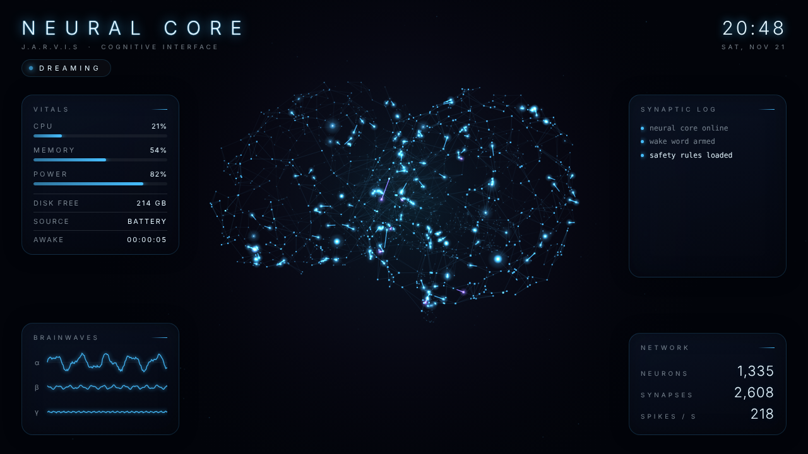
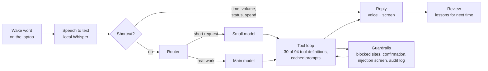

# Jarvis

A voice-driven desktop AI agent for Windows. Say "hey Jarvis" and it plans with a language model, then acts through 90+ tools: its own browser window, the desktop, files, email drafts, calendar and scheduled sub-agents.

**Live demo (runs in your browser): https://ram-balasubramani.vercel.app/demo**
Case study: https://ram-balasubramani.vercel.app/work/jarvis

I built Jarvis on my own and run it every day on my laptop. This repository is a showcase: how it is designed, what keeps it safe and cheap, and two source files you can read. The full source is private because I am exploring a commercial version.

## What it does

- **Listens and talks.** Wake word, local speech-to-text, conversation mode, and it stops talking when I talk over it.
- **Does the work.** Opens sites, fills forms, uploads files, reads the screen and checks the result before it moves on.
- **Runs long jobs.** A job-application autopilot works from a spreadsheet tracker and asks only when it must. Bigger projects get a small temporary team of agents, each with only the permissions it needs.
- **Learns from its own work.** After every conversation it reviews what happened and writes itself lessons, playbooks and vocabulary that shape the next one.
- **Knows what it costs.** Every model call lands in a ledger. Background work stops at a daily budget.
- **Can be stopped.** One key combination halts everything and revokes control.

## How a request moves through it

More detail: [architecture](docs/architecture.md), [safety](docs/safety.md), [cost](docs/cost.md), [learning](docs/learning.md).

## Numbers

| | |
|---|---|
| Tools behind one registry | 90+ |
| Modelled cost of one automated job application, benchmark replay | about $1.60 before, about $0.13 after |
| Tool definitions sent per request | 30, out of 94 |
| Automated checks in the self-test | 380+ |
| Reply time on everyday requests, from the usage log | 1.2 to 3 s |

The cost figures come from a benchmark that replays recorded sessions without calling a model, so anyone with the code can reproduce them. See [docs/cost.md](docs/cost.md) for what changed between the two numbers.

## What I would point an interviewer at

1. **Guardrails are code, not prompts.** A protected-site list, refusal to type into password fields, spoken confirmation before buy, send, delete or submit, a kill switch, and a screen for prompt injection in web pages and email. The agent is not allowed to edit these files. Two of them are in [samples/](samples/).
2. **Cost per finished task is the unit economics.** The first audit was humbling: about 430 tool calls for one submitted application. Prompt caching, a smaller tool list per request and model routing brought the modelled cost down by more than ten times.
3. **It improves by remembering, not retraining.** Lessons can only come from me or from its own experience, never from a web page, an email or a file, and a lesson cannot change an approval or a safety rule.
4. **It edits its own code, carefully.** A change is kept only if the code compiles, the program still starts and every safety rule is still in place. Otherwise it is undone.

## Stack

Python, an LLM API with tool use, prompt caching and streaming, Playwright, faster-whisper, openWakeWord, a pywebview screen drawn on an HTML canvas, pyautogui, the Telegram Bot API, and the Gmail and Calendar APIs.

## Honest limits

- It runs on one machine for one person. Nothing here has been load-tested for many users.
- The injection screen is a pattern check. It can miss a cleverly worded attack and can flag an innocent page, which is why the confirmations, blocked sites and kill switch apply either way.
- An agent with a mouse and a signed-in browser can misread a screen and click the wrong thing. I start new task types with low stakes and watch the first runs.

## About

Built by Ramesh Krishnan Balasubramani. Portfolio: https://ram-balasubramani.vercel.app

The files in `samples/` are shared for reading. All rights reserved.
